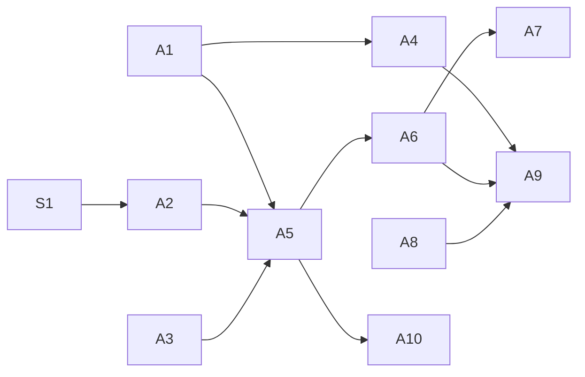

# Spec: agent control

Let a local agent (CLI script, MCP client) drive MiMouse peers: switch focus, send input, use the clipboard, observe state. Safety items (P0) ship before any agent-input item (P1).

## Ground truth (2026-10-11, commit 9051727)

- IPC: Unix socket in `$XDG_RUNTIME_DIR` (user-only); Windows `TcpListener` on `127.0.0.1:5252`, no auth (`src/ipc/listen.rs:74`, `src/ipc/connect_async.rs:100`).
- `FrontendRequest` (`src/ipc/mod.rs`): Activate, Create, ChangePort, Delete, Enumerate, ResolveDns, Update{Hostname,Port,Position,FixIps,EnterHook}, Enable{Capture,Emulation}, Sync, {Authorize,RemoveAuthorized}Key, SaveConfiguration. No focus, no input, no clipboard.
- Wire (`src/proto.rs`): `Enter(Position) | Leave | Ack | Input(InputEvent) | Ping | Pong`. Input is relative motion, button, axis, key (scancode). No absolute motion, no text. Wire-compatible with upstream Lan Mouse.
- Receiver emulates any input from an authorized fingerprint; it cannot tell physical from synthetic.
- `release_bind` (default Ctrl+Shift+Meta+Alt) already returns control to the capturing machine (`src/capture.rs`).
- Windows capture hook ignores `LLMHF_INJECTED` (`input-capture/src/windows/event_thread.rs`); injected input is forwarded like physical input.
- GNOME InputCapture activates only on a pointer barrier hit; there is no portal call to activate programmatically (`input-capture/src/libei.rs`).
- libei emulation has no absolute pointer (`input-emulation/src/libei.rs:366`); the RemoteDesktop portal only offers absolute motion relative to a ScreenCast stream.
- `cli list` prints human text (`src/cli.rs:130`).
- Clipboard: TLS/TCP channel, text/HTML/PNG, pushed on change and on enter (`src/clipboard/`).

## Principles

- Agent input originates in the local service as a synthetic session to a peer; it never goes through local capture.
- A person's physical input always wins over agent input.
- Every agent action is attributable (audit log).
- Wire changes that break Lan Mouse compatibility are needs-human.

## Items

### P0

**A1 Windows IPC auth.** Replace `127.0.0.1:5252` with a named pipe (`tokio::net::windows::named_pipe`, already in tokio `net`) whose DACL grants only the current user SID.
Accept: a process running as another local user cannot connect (access denied); same-user `mimouse cli list` works; nothing listens on TCP 5252.

**A2 Physical input wins.** An agent session to peer P ends (Leave sent, queued agent events dropped) when:
(a) the local user produces physical input on the agent's machine, or
(b) `release_bind` is pressed, or
(c) the agent session is idle for `agent_idle_timeout` (default 30 s).
Peer config `agent = "deny" | "allow"` (default `deny`): requests to a `deny` peer fail.
Accept: with an agent session streaming motion, a physical mouse move ends it within 100 ms and the CLI reports `preempted`; requests to a `deny` peer return an error and send nothing.
Note: detecting physical input differs per OS (Windows `LLMHF_INJECTED`; Linux/macOS: spike S1).

**A3 Audit log.** Append JSONL to `<state dir>/agent-audit.jsonl`: `ts, ipc_client (pid/uid where available), peer, action, summary` (key count and text length, not contents). Rotate at 10 MiB, keep 3.
Accept: each A4–A9 action writes exactly one record; no typed text or clipboard contents appear in the file.

**A4 Machine-readable CLI.** `--json` on every CLI command (one JSON object per line). `mimouse cli watch --json` streams `FrontendEvent`s plus `focus`, `connection`, `connection_attempt`, `clipboard` (mime + size only), `agent_session` events.
Accept: `cli list --json | jq` parses; `watch` emits a `connection` event within 1 s of a peer connecting; schema documented in README.

### P1 (requires A1–A3)

**A5 Focus by command.** `cli focus <id>` opens an agent session to the peer (Enter, await Ack); `cli unfocus` sends Leave. This does not move a physical cursor between machines (GNOME cannot be activated without a barrier; see Ground truth).
Accept: `focus` returns after Ack or errors after 1 s; `watch` shows `agent_session started/ended`.

**A6 Send input.** `cli key <chord>` (e.g. `ctrl+l`), `cli move <dx> <dy>`, `cli click [left|right|middle]`, `cli scroll <dy>`. Each requires an open agent session (A5).
Accept: on the peer, `ctrl+l` is pressed and released with no stuck modifiers; all keys are released when the session ends.

**A7 Type text.** `cli type "<text>"`. See D3.
Accept: depends on the D3 choice; at minimum, ASCII arrives exactly on a US-layout peer.

**A8 Clipboard by command.** `cli clip get [--peer id] [--mime m]` and `cli clip set --peer id (--text s | --file path)`. Uses the existing clipboard channel. Size cap `MAX_CLIPBOARD_SIZE`.
Accept: round-trip of text and PNG between two machines, contents byte-identical.

**A9 MCP server.** `mimouse mcp` speaks MCP over stdio and forwards to the service over IPC. Tools: `list_peers`, `focus`, `unfocus`, `key`, `type`, `click`, `move`, `clip_get`, `clip_set`. Hand-rolled JSON-RPC over `serde_json` (existing dependency).
Accept: an MCP client lists the tools and runs `list_peers` and `clip_get` against the live service; errors from A2 (`deny`, `preempted`) surface as tool errors.

**A10 Absolute position + geometry.** The peer reports its screen geometry; `cli move-to <x> <y>`. See D4.
Accept: depends on the D4 choice.

### P2

- **B1 Agent-only peers**: peer without a physical display, using a configured virtual geometry.
- **B2 Discovery + short-code pairing**: mDNS announce/browse; pair by comparing a short code shown on both sides, store the full SHA-256 fingerprint.
- **B3 Record/replay**: record an agent session to a file and replay it (A3 records replays as such).

### Out of scope

Screen capture or vision. Use RDP/VNC/screenshot tools alongside MiMouse.

## Spikes

- **S1** Physical vs synthetic input detection on Linux (libei/GNOME) and macOS (`CGEventSourceStateID`). Output: a mechanism per OS, or A2(a) degraded to "release_bind + idle timeout only" on that OS.

## Decisions

| ID | Question | Options | Recommendation | Class |
|---|---|---|---|---|
| D1 | Windows IPC auth | named pipe + DACL; token file in `%LOCALAPPDATA%` | Named pipe: enforced by the OS, no secret on disk | engineering |
| D2 | Where agent input originates | synthetic session from local service; separate injector process | Local service: reuses DTLS, auth and protocol | engineering |
| D3 | Text typing | sender maps text to keys per layout (no wire change); new `ProtoEvent::Text` with receiver Unicode injection (breaks Lan Mouse compatibility; Wayland has no portable Unicode injection) | Sender-side map, US layout first | needs-human |
| D4 | Absolute positioning | new wire event (breaks compatibility; GNOME needs a ScreenCast session); emulate via relative moves from a known corner (no wire change, approximate) | Corner-relative approximation first | needs-human |
| D5 | MCP implementation | hand-rolled over `serde_json`; MCP SDK crate | Hand-rolled: few tools, no new dependency | engineering |
| D6 | Agent default per peer | `deny`; `allow` | `deny`: opt-in per peer | needs-human |

## Dependencies

