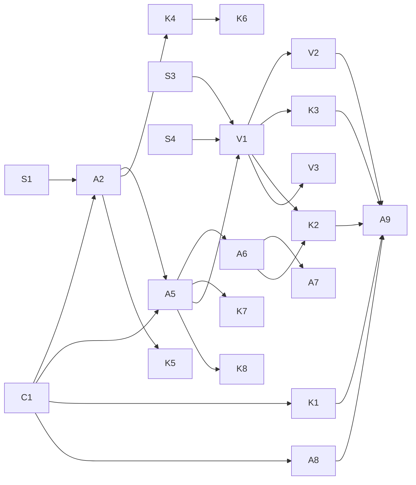

# Spec: agent control

Let a local agent (CLI script, MCP client, computer-use loop) observe and drive MiMouse machines, including its own: see the screen, read the UI tree, send input, use the clipboard. MiMouse is the sensor/actuator layer; planning lives in the agent. Safety items (P0) ship before any agent item (P1).

Status (2026-10-18, `main` b39f6d8): P0 done; nothing of P1/P2 is implemented. Refreshed from the 2026-10-11 version (commit 9051727): ground truth rewritten, C1/A2/A5/A6/A8/V1/V2 revised, K1-K8 and D9-D11 added.

## Ground truth (2026-10-18, b39f6d8)

- **IPC.** Unix socket `mimouse-socket.sock` in `$XDG_RUNTIME_DIR` (user-only); Windows named pipe `\\.\pipe\mimouse-<user SID>`, owner/DACL current user only, remote clients rejected, CLI verifies the owner (`src/ipc/windows.rs`). Newline-delimited JSON, one `Reply` per `seq`; CLI `REPLY_TIMEOUT` 5 s (`src/cli.rs:56`), exempt: `watch`, `pair`.
- **Requests** (`FrontendRequest`, `src/ipc/mod.rs:467`): client CRUD (AddClient, RemoveClient, Set{Host,Port,Position,Ips,EnterHook}), Activate/Deactivate, List, ChangePort, Enable{Capture,Emulation}, {Authorize,RemoveAuthorized}Key, SaveConfig, Focus, Pair/PairAccept/PairConfirm/PairCancel, Config, Telemetry*. No input, text, pointer, clipboard, screen or UI request.
- **Events** (`FrontendEvent`, `src/ipc/mod.rs:228`, streamed by `cli watch --json`): Clients, Created, State, Deleted, Port, Capture, Emulation, ClipboardStatus, AuthorizedKeys, Fingerprint, Connection, Entered, Disconnected, ConnectionAttempt, Clipboard{direction, peer, mime, size}, PairCode, Paired, PairFailed. New fields must be `Option` + `#[serde(default)]`.
- **Audit** (`src/audit.rs`): `audit.jsonl` {ts, requester {pid, uid, exe}, action, details, result} for every non-read-only request, 0600, own thread, rotated at 10 MiB × 3.
- **Peer channels.**
  - DTLS/UDP input (`src/proto.rs`): Lan Mouse-compatible relative motion and scancodes, plus `EnterAt` (two trailing bytes); the receiver cannot tell synthetic from physical input.
  - TLS/TCP on the same port (`src/clipboard/transport.rs`): mutual fingerprint auth (`crypto::peers::Policy`), demultiplexed by ALPN in `transport::listen` (`:270`): `mimouse-pair/1` = pairing, no ALPN = clipboard (one update per connection, `len u32 | payload`, 1-byte ACK). `MAX_CONNECTIONS` 16 (pairing included), revocation re-checked every 500 ms. Pairing is served even with clipboard off.
- **Absolute pointer exists** for the entry point (`Emulation::enter_at`, `input-emulation/src/lib.rs:398`): libei (`PointerAbsolute`, EIS regions, logical px), wlroots (`motion_absolute`), X11 (XTest, one screen), Windows (`SetCursorPos`, `EnumDisplayMonitors`, physical px), macOS (CG global points). Only the remote-desktop portal fallback (`xdp`) can't. `geometry.rs` is pure; no process sets DPI awareness on Windows.
- **Capture switching.** `cli focus <id>` works everywhere; libei/layer-shell/X11 answer `FocusByPointerPush` and emulation pushes the pointer through the barrier (works on GNOME 50).
- **Held input.** `normalize::Peer` tracks keys/buttons per `EmulationHandle` and releases them on `destroy`/`terminate`; `src/emulation.rs` allocates handles from `next_id` keyed by peer address, `PUSH_HANDLE = u64::MAX` is reserved.
- **Physical vs injected.** Windows hooks never check `LLMHF_INJECTED`/`LLKHF_INJECTED`; only moves tagged `IDLE_KEEPALIVE_TAG` pass. MiMouse's own `SendInput` is untagged (`dwExtraInfo: 0`). Linux and macOS: no mechanism.
- **Clipboard.** `ClipboardTask.current` holds the latest local or received contents (`src/clipboard/mod.rs:534`); inbound updates go through `received()` → `SetRequest`; backends implement `clipboard::backend::Backend` (portal, Windows); no macOS backend; nothing runs when `clipboard = false`.
- **GNOME portal sessions** are four separate ones, none with ScreenCast: libei emulation RemoteDesktop (`remote-desktop.token`), xdp fallback RemoteDesktop (no token), clipboard RemoteDesktop (`clipboard.token`), InputCapture (`input-capture.token`, remembered only with xdg-desktop-portal-gnome ≥ 51). ashpd `screencast` is enabled in `input-emulation/Cargo.toml` but unused; no PipeWire.
- **Text input:** absent (no `KEYEVENTF_UNICODE`, `CGEventKeyboardSetUnicodeString` or keysym lookup). `input-event` carries evdev scancodes only.
- **Notices** (`src/notify.rs`): Linux freedesktop notification, Windows tray balloon, macOS `osascript`; `switched`, `awaiting_approval`, `unauthorized`. One new method per notice kind.
- **Idle inhibit** (`src/inhibit.rs`) is held while this machine controls another; reusable for agent sessions.
- **Config:** no grant keys and no `[self]` section; trust is `authorized_fingerprints` + per-client `fingerprint` pin.

## Principles

- **One request set, three surfaces (D9).** The service's typed requests are the API. The CLI (`--json`) and the MCP server are thin adapters over the same IPC requests; the action vocabulary also covers the computer-use tools of current models (screenshot, click/move at x,y, type, key, scroll), so an agent loop can use MiMouse as its executor without a translation layer. No HTTP or gRPC server.
- **Agent channel.** All agent traffic between machines uses typed requests on the TLS/TCP listener under its own ALPN `mimouse-agent/1`. The DTLS input channel stays Lan Mouse-compatible and human-only.
- **Target `self` or a peer.** The local machine is a valid target and goes through the same request path with no network hop.
- **The target decides.** Grants are configured and enforced on the machine being controlled or observed, never by the requester.
- **The person wins.** Physical input on the target ends the agent session; the agent gets `preempted`.
- **No indirect control (D11).** A target that is sending (capturing for another machine) refuses agent input, and capture starting ends the session; otherwise injected input would be captured and forwarded to a third machine, which the sending-or-receiving invariant forbids.
- **One coordinate space per target (D10).** Requests use the target's screenshot pixel space (physical px, origin top-left of the virtual desktop). The target converts to its backend's space (logical px via EIS region scale on GNOME, points on macOS). Adapters that downscale images (MCP) scale coordinates back before sending.
- **Structure before pixels.** Prefer UI tree, clipboard and CLI over screenshots; pixels are the fallback.
- **Attributable.** Every agent request is audited on both requester and target; contents (text, clipboard, pixels) are never logged.

## Items

### P0 (done)

**A1 Windows IPC auth.** Done (40cdba1): per-user named pipe with owner-only DACL, remote clients rejected, CLI refuses a pipe owned by another user; nothing listens on TCP 5252.

**A3 Audit log.** Done (40cdba1): see Ground truth. P1 adds agent requests on requester and target, sizes and counts only.

**A4 Machine-readable CLI.** Done (40cdba1): `--json` on every command, non-zero exit on failure, `cli watch [--json]`, schema in README. P1 adds `agent_session` and `preempted` events.

### P1 (requires A1, A3)

**C1 Agent channel.** [REVISED 2026-10-18: own ALPN instead of generalizing the clipboard frames.] A sibling of `pair::is_pairing` in `transport::listen` routes ALPN `mimouse-agent/1` to an agent handler with its own `ServerConfig`, served also with clipboard off and from `listen_only`. One TLS connection per session; versioned typed request/response frames (`len u32 | version u8 | type u8 | body`): `Hello` (capabilities, K1), `Session{open,close}`, `Key`, `Text`, `PointerTo`, `PointerMove`, `Button`, `Scroll`, `Screenshot`, `Geometry`, `ClipGet`, `ClipSet`, `UiTree` (P2). Fingerprint re-checked like clipboard (`Policy::check` every `REVOCATION_CHECK`); counts against `MAX_CONNECTIONS`. Clipboard (no ALPN) and pairing frames stay byte-identical.
Accept: existing clipboard and pairing smoke pass unchanged; an unknown request type returns an error frame, not a dropped connection; revoking the requester's fingerprint ends its session within 1 s.

**A2 Grants and preemption** (ships with C1 + A5). Per-peer grants on the target, `[agent]` table keyed by fingerprint plus `[agent.self]`: `input`, `screen`, `clipboard` = `"deny" | "ask" | "allow"` (default `deny`, D6; `ask` = K4 prompt). Validated in `ConfigToml::validate`, live-reloaded. A session ends (handle destroyed, keys released, `preempted` to the requester) on physical input on the target, `release_bind`, Ctrl double-tap, capture starting (D11), or `agent_idle_timeout` (default 30 s).
- Windows: agent `SendInput` tagged `dwExtraInfo = AGENT_TAG`; the LL hooks treat untagged `LLMHF_INJECTED`/`LLKHF_INJECTED` events from other software as non-physical and tagged ones as the agent's, everything else as physical.
- Linux, macOS: S1.
Accept: a request without the grant is rejected by the target and nothing is injected; with a session streaming motion, physical mouse movement on the target ends it within 100 ms; `cli focus` on the target ends its agent session.

**A5 Session.** `cli session open <target>` / `close`. Opening sends `Hello`, validates grants on the target, allocates an emulation handle from `next_id` keyed by session (not address) and starts A2 monitoring and the K7 inhibit. An agent session never moves the person's control: it is not a crossing and does not call `Focus`. [REVISED: reconciles opportunities.md:3; `cli focus` is the human switch, sessions are separate.]
Accept: `watch` shows `agent_session started/ended/preempted` on both ends; closing releases everything the session held.

**A6 Input.** `cli key <chord>`, `cli move <dx> <dy>`, `cli click [button] [--double]`, `cli scroll <dy>`, injected by the target's emulation backend under the session's handle (so `normalize` tracks and releases held input).
Accept: `ctrl+l` pressed and released on the target with no stuck modifiers; all keys released when the session ends or the connection drops.

**A7 Text.** `cli type "<text>"`. The target maps text to its own layout (D3): Windows `KEYEVENTF_UNICODE`; macOS `CGEventKeyboardSetUnicodeString`; GNOME/wlroots keysym lookup in the active keymap, reporting characters with no mapping; X11 keysym → keycode via XTest.
Accept: `grüße ✓` arrives exactly on Windows; on GNOME, characters in the active layout arrive exactly and the rest are reported as unmapped, not dropped silently.

**A8 Clipboard.** [REVISED: reuses the clipboard task.] `cli clip get|set <target> [--mime m] (--text s | --file path)`, capped at `MAX_CLIPBOARD_SIZE`. `get` reads `ClipboardTask.current` through a new task `Request`; `set` goes through `received()` as a local accept (`accepted = now`), so the clipboard rules (latest wins, older-than-local dropped) hold. Unavailable with `clipboard = false` or on macOS (no backend): error `clipboard_unavailable`, reported in K1.
Accept: text and PNG round-trip byte-identical between two machines and on `self`; a secret-marked local copy reads as `not_shared`.

**V1 Screenshot + geometry.** `cli screenshot <target> [--monitor n] [--region x,y,w,h] [--max-edge px] [--format png|jpeg] -o file` returns the image plus geometry (monitors, origin, physical size, scale, applied downscale factor).
- Windows: GDI BitBlt per monitor from a per-monitor-DPI-aware-v2 thread (S3).
- GNOME: ScreenCast source on the libei emulation's RemoteDesktop session (one consent, `remote-desktop.token` reused), one PipeWire frame (D7). Adds `libpipewire-0.3` to the rpm requires.
- wlroots: `wlr-screencopy`. X11: `XGetImage`. macOS: ScreenCaptureKit (Screen Recording permission, asked only by `macos_permissions`).
- Locked or secure desktop: returns `unavailable` with the state, never a stale frame.
Accept: on megapc (mixed-DPI 4880×2560 virtual desktop) a screenshot's pixel at a known window corner matches `Geometry`; `screen = deny` returns an error and captures nothing.

**V2 Absolute pointer.** [REVISED: the per-backend absolute code exists for `enter_at`; V2 generalizes it.] `cli pointer-to <target> <x> <y>` in V1 coordinates. New `Emulation::pointer_to(handle, x, y)` sharing each backend's `enter_at` path: libei `PointerAbsolute` (regions give the logical scale), wlroots `motion_absolute`, X11 XTest, Windows `SendInput` absolute normalized to the virtual desk (tagged, A2) instead of `SetCursorPos`, macOS CG. `xdp` fallback: `unsupported` in K1.
Accept: `pointer-to` the centre of a button found in a V1 screenshot, then `click`, activates that button on Windows and GNOME (D4).

**A9 MCP server.** `mimouse mcp` over stdio, forwarding to the local service over IPC (D5, D9). Tools: `list_targets` (K1), `session_open`, `session_close`, `screenshot` (image content block, downscaled to `--max-edge`, default 1568 px, coordinates mapped back), `pointer_to`, `click`, `key`, `type`, `scroll`, `clip_get`, `clip_set`, `request_human` (K6), `ui_tree` (P2). Action tools take `observe` (K2). Tool annotations: `readOnlyHint` on `list_targets`/`screenshot`/`clip_get`, `destructiveHint` on input tools. No HTTP transport.
Accept: an MCP client completes "screenshot → pointer_to → click → screenshot" on a peer; `deny`, `preempted` and `unavailable` surface as tool errors with a reason the model can act on.

**K1 Capabilities and state.** `Hello`/`cli targets --json`/`list_targets` return per target: OS, desktop, backends, monitors, grants for this requester, capabilities (screen, absolute pointer, exact text, clipboard, UI tree) and state (locked, secure desktop, display off, capturing, person active in the last N s, session held by another requester). Agents pick a strategy instead of discovering failures one call at a time.
Accept: on gpumaster with `xdp` emulation forced, `absolute_pointer: false`; a locked megapc reports `locked` and every input request fails with that state.

**K2 Act, then observe.** Every action request takes optional `observe: {screenshot: bool, settle_ms, wait_change_ms}`: after injecting, the target waits until the frame stops changing for `settle_ms` (or `wait_change_ms` passes) and returns the frame. One round trip per agent step; absorbs V4.
Accept: `click --observe` returns a frame showing the click's effect on a menu that animates for 200 ms, in one request.

**K3 Model-sized frames.** Screenshots default to a long edge the model accepts (1568 px), JPEG as an option, `--region` for zooming into small text; the response carries the downscale factor, and the MCP adapter maps model coordinates back (D10). Optional cursor overlay.
Accept: a 4880×2560 megapc frame arrives at ≤1568 px wide with factor 3.11; a click at the downscaled centre of a button lands on it.

**K4 Person in the loop on the target.** Grant value `ask`: `session open` shows a notice on the target ("<requester> wants input/screen for <reason>") and waits up to 60 s for the person to accept with `release_bind` or `mimouse cli agent accept`; no answer = deny. While a session is open the target shows an indicator (D8) and `mimouse cli agent off` refuses all agent sessions until `agent on`.
Accept: with `input = "ask"`, an unattended target denies after 60 s and injects nothing; `agent off` ends an open session within 100 ms.

**K5 Time-boxed grants.** `mimouse cli agent grant <peer|self> <input|screen|clipboard> [--for 30m]` writes the grant through `Config::save` with an expiry; expired grants read as `deny` and the expiry is audited.
Accept: a 1-minute grant stops accepting requests after 60 s without a restart.

**K6 Handoff to a person.** `request_human(reason)` shows a notice on the target (CAPTCHA, 2FA, payment) and returns when the person signals done (`cli agent resume` or `release_bind` twice) or after a timeout; after `preempted`, the requester gets `resumable` once the target has seen no physical input for `agent_resume_idle` (default 10 s).
Accept: an MCP `request_human` call blocks until `cli agent resume` on the target, then the next action succeeds without reopening the session.

**K7 Keep the target usable.** An open session holds the target's idle inhibit (`inhibit.rs`) so the screen doesn't lock mid-task; released with the session (`RELEASE_DELAY`).
Accept: a 20-minute session on a target with a 5-minute lock timeout stays unlocked; the inhibit is gone 5 s after close.

**K8 Agent telemetry.** Counters only, in `telemetry::COUNTERS`: sessions, actions by type, preemptions, denials, handoffs; schema bump per the telemetry rules. Never targets, text, coordinates or images.
Accept: the no-PII test covers the new fields.

### P2

- **V3 UI tree** (highest-value P2; Windows first, megapc is the main target): `cli ui-tree <target> [--window focused|all] [--depth n]` returns JSON nodes `{id, role, name, value, states, bounds}` with bounds in V1 coordinates, plus `cli ui-act <target> <id> invoke|focus|set-value`. Windows UI Automation (`Win32_UI_Accessibility`), Linux AT-SPI over D-Bus (zbus already in the tree via ashpd), macOS AX. Password fields report `protected` with no value.
- **W1 Windows and apps:** `cli windows <target>` (title, app, bounds, focused), `focus-window <id>`, `open <url|path>` with the OS default handler under a new grant `launch`. Windows first (`EnumWindows`); GNOME has no window list for an unsandboxed client, so `unsupported` in K1.
- **F1 File transfer:** `cli send-file <target> <path>` / `get-file` reusing the clipboard v2 file streaming and `files::valid_name`, grant `files`, `max_file_size` cap.
- **R1 Sensitive-window guard:** per-target denylist of apps (password managers, banking); input and screenshots refused while one is focused (Windows `GetForegroundWindow` exe; degraded to `unsupported` where focus is unknown).
- **B1 Agent-only targets:** headless machines or VMs with a configured virtual geometry.
- **B3 Record/replay** of agent sessions, opt-in and local to the target (audited as replays).
- [REVISED: B2 discovery + short-code pairing is done: `cli pair` (6-digit code, mutual confirm) and `cli discover` (tailnet).]

### Out of scope

- Continuous video streaming or remote viewing for people. Use GNOME Remote Desktop (RDP) on Linux, or VNC/RustDesk for a live Windows console (Windows RDP takes over the console session).
- Model, planner or OCR inside MiMouse.
- Arbitrary command execution on the target: use SSH; MiMouse grants cover input, screen, clipboard, files and launch only.
- A network-facing API (HTTP, gRPC, remote MCP): remote targets are reached through the authenticated peer channel, never a new port (D9).

## Spikes

- **S1** Physical vs synthetic input on the target for Linux (GNOME/libei, wlroots, X11) and macOS (`CGEventSourceStateID`, event source user data). Output: a mechanism per OS, or A2 preemption on that OS degraded to `release_bind` + idle timeout + K4 indicator.
- **S2** GNOME Screenshot portal for an unsandboxed daemon: does `interactive=false` work without a per-call dialog. Decides the D7 fallback.
- **S3** Windows mixed DPI: BitBlt, `SendInput` absolute and `EnumDisplayMonitors` agree on megapc's virtual desktop from a per-monitor-DPI-aware-v2 thread.
- **S4** GNOME: a ScreenCast source selected on the libei emulation's RemoteDesktop session keeps `connect_to_eis` working and restores without a dialog from `remote-desktop.token`.

## Decisions

| ID | Question | Options | Recommendation | Class |
|---|---|---|---|---|
| D1 | Windows IPC auth | named pipe + DACL; token file | **Done:** named pipe | decided |
| D2 | Agent transport | DTLS input channel; MiMouse TLS channel | TLS channel, own ALPN `mimouse-agent/1` (C1) | engineering |
| D3 | Text typing | sender maps text to keys; target maps to its own layout | Target-side: it knows its layout and OS Unicode APIs | engineering |
| D4 | Absolute pointer | approximate via relative moves; real absolute via OS APIs | Real absolute, generalizing `enter_at` (V2) | engineering |
| D5 | MCP implementation | hand-rolled over `serde_json`; SDK crate (`rmcp`) | Hand-rolled: ~14 tools, stdio only, no new dependency; revisit if MCP features beyond tools (resources, elicitation) are needed | engineering |
| D6 | Default grants | `deny`; `allow` | **Decided:** `deny` for every grant, opt-in per peer and `self` | decided |
| D7 | GNOME screen capture | ScreenCast + PipeWire on the emulation RemoteDesktop session; Screenshot portal | ScreenCast (S4): repeated silent frames under one consent. [REVISED: no longer needed for V2, libei already places absolutely; Screenshot portal is viable if S2 shows no per-call dialog and avoids the PipeWire dependency] | engineering |
| D8 | Visible indicator while an agent session is open | none (audit only); notice per session; persistent indicator | Notice at session start and end on every OS (`notify.rs` exists: Linux notification, Windows tray balloon, macOS), plus the Windows tray icon tooltip while open | needs-human |
| D9 | Agent interface | MCP only; CLI only; HTTP/REST API; gRPC/JSON-RPC SDK; layered | **Layered:** typed IPC requests are the API; `cli --json` and `mimouse mcp` (stdio) are thin adapters; action names match computer-use tools. No HTTP (a local port is reachable by browsers and other users, the reason A1 removed TCP 5252) and no gRPC (no agent host speaks it, adds protobuf/HTTP2) | engineering |
| D10 | Coordinate space | logical px; physical px; per-request space | Target screenshot pixels (physical); target converts; adapters undo their downscale | engineering |
| D11 | Agent input while the target is sending | allow; refuse | Refuse, and end the session when capture starts (sending-or-receiving invariant) | engineering |

## Dependencies

