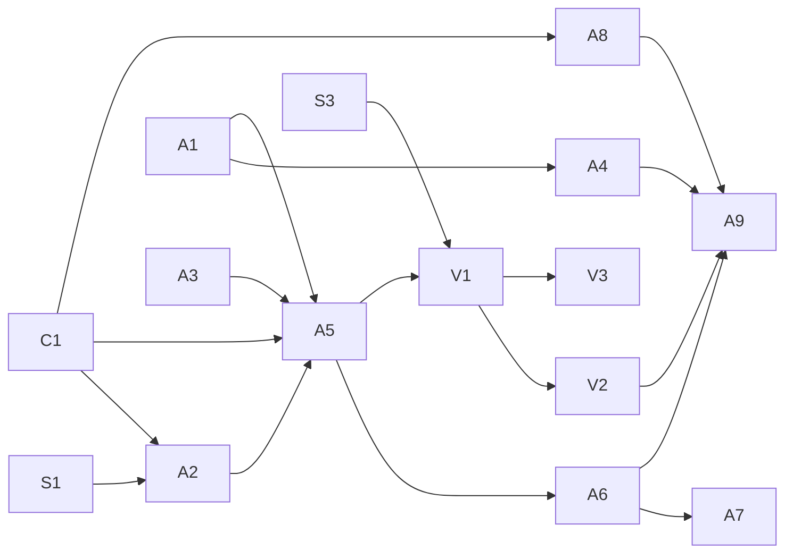

# Spec: agent control

Let a local agent (CLI script, MCP client) observe and drive MiMouse machines, including its own: see the screen, read the UI tree, send input, use the clipboard. MiMouse is the sensor/actuator layer; planning lives in the agent. Safety items (P0) ship before any agent item (P1).

## Ground truth (2026-10-11, commit 9051727)

- IPC: Unix socket in `$XDG_RUNTIME_DIR` (user-only); Windows `TcpListener` on `127.0.0.1:5252`, no auth (`src/ipc/listen.rs:74`, `src/ipc/connect_async.rs:100`).
- `FrontendRequest` (`src/ipc/mod.rs`): Activate, Create, ChangePort, Delete, Enumerate, ResolveDns, Update{Hostname,Port,Position,FixIps,EnterHook}, Enable{Capture,Emulation}, Sync, {Authorize,RemoveAuthorized}Key, SaveConfiguration. No focus, input, clipboard or screen.
- Two peer channels:
  - DTLS/UDP input (`src/proto.rs`): `Enter | Leave | Ack | Input | Ping | Pong`, relative motion and scancodes only; wire-compatible with upstream Lan Mouse; the receiver cannot tell synthetic from physical input.
  - TLS/TCP on the same port (`src/clipboard/transport.rs`): MiMouse-only, mutual fingerprint auth, length-prefixed frames, one update per connection.
- `release_bind` (default Ctrl+Shift+Meta+Alt) returns control to the capturing machine (`src/capture.rs`).
- Windows capture hook ignores `LLMHF_INJECTED` (`input-capture/src/windows/event_thread.rs`).
- GNOME InputCapture activates only on a barrier hit (`input-capture/src/libei.rs`).
- libei emulation has no absolute pointer (`input-emulation/src/libei.rs:366`). ashpd 0.13.9 ships `screencast`, `screenshot` and `RemoteDesktop::notify_pointer_motion_absolute` (absolute motion requires a ScreenCast stream in the same session).
- GNOME consent is stored as restore tokens in `~/.cache/mimouse/{remote-desktop,clipboard}.token`.
- `windows` crate already enables `Win32_Graphics_Gdi` (BitBlt) in `input-capture` and `input-emulation` Cargo.toml.
- `cli list` prints human text (`src/cli.rs:130`).

## Principles

- **Agent channel.** All agent traffic (input, text, pointer, clipboard, screen, UI tree) uses typed requests on the TLS/TCP channel. The DTLS input channel stays Lan Mouse-compatible and human-only.
- **Target `self` or a peer.** The local machine is a valid target and goes through the same request path with no network hop.
- **The target decides.** Grants (`agent`, `screen`) are configured and enforced on the machine being controlled or observed, never by the requester.
- **The person wins.** Physical input on the target ends the agent session.
- **One coordinate space.** Screenshot pixels, UI-tree bounds and absolute pointer coordinates are the same per-target physical-pixel space.
- **Structure before pixels.** Prefer UI tree, clipboard and CLI over screenshots; pixels are the fallback.
- **Attributable.** Every agent request is audited on both requester and target; contents are never logged.

## Items

### P0

**A1 Windows IPC auth.** Replace `127.0.0.1:5252` with a per-user named pipe `\\.\pipe\mimouse-<user SID>` (`tokio::net::windows::named_pipe`), owner and DACL set to the current user SID only, remote clients rejected. The CLI refuses a pipe whose owner is not the current user (squatting).
Accept: another local user gets access denied; same-user `mimouse cli list` works; nothing listens on TCP 5252.

**A3 Audit log.** JSONL at `<config dir>/audit.jsonl`: `ts, requester {pid, uid, exe}, action, details`. P0 records every state-changing local control request (add/remove/activate peers, trust changes, enter hooks, port, save); P1 adds agent requests on requester and target, with sizes and counts only. Rotate at 10 MiB, keep 3.
Accept: each state-changing CLI command writes one record naming the requesting process; read-only commands (`list`, `watch`) write none; no typed text, clipboard contents or image bytes ever.

**A4 Machine-readable CLI.** `--json` on every CLI command; commands wait until the service has applied the request and exit non-zero on failure (e.g. unknown client id). `mimouse cli watch [--json]` streams state, connection, connection_attempt and clipboard (mime + size) events; P1 adds agent_session and preempted.
Accept: `cli list --json | jq` parses; `cli activate <unknown>` exits 1; `watch` emits `connection` within 1 s of a peer connecting; schema in README.

### P1 (requires A1, A3)

**C1 Agent channel.** Generalize the clipboard transport into versioned, typed request/response frames over the same TLS listener: `Clipboard` (existing), `Session{open,close}`, `Key`, `Text`, `PointerTo`, `PointerMove`, `Button`, `Scroll`, `Screenshot`, `UiTree`, `Geometry`. Clipboard push keeps working between MiMouse peers.
Accept: existing clipboard smoke passes unchanged; an unknown request type returns an error frame, not a dropped connection.

**A2 Grants and preemption** (ships with C1 + A5, where it can be exercised). Per-peer grants on the target: `agent = "deny" | "allow"` and `screen = "deny" | "allow"` (default `deny`, D6). Requests to `self` are subject to `[self]` grants (default `deny`). An agent session on a target ends (keys released, `preempted` returned to the requester) when the target sees physical input, or `release_bind`, or `agent_idle_timeout` (default 30 s).
Accept: a request without the grant is rejected by the target and nothing is injected; with a session streaming motion, physical mouse movement on the target ends it within 100 ms.
Note: physical-input detection per OS: Windows `LLMHF_INJECTED`/`LLKHF_INJECTED`; Linux and macOS spike S1.

**A5 Session.** `cli session open <target>` / `close`. Opening validates grants on the target and starts A2 preemption monitoring.
Accept: `watch` shows `agent_session started/ended/preempted`.

**A6 Input.** `cli key <chord>`, `cli move <dx> <dy>`, `cli click [button]`, `cli scroll <dy>`, injected by the target's emulation backend.
Accept: `ctrl+l` pressed and released on the target with no stuck modifiers; all keys released when the session ends.

**A7 Text.** `cli type "<text>"`. The target maps text to its own layout (D3): Windows `KEYEVENTF_UNICODE`; macOS `CGEventKeyboardSetUnicodeString`; GNOME keysym lookup in the libei keymap, failing characters with no mapping.
Accept: `grüße ✓` arrives exactly on Windows; on GNOME, characters in the active layout arrive exactly and the rest are reported as unmapped.

**A8 Clipboard.** `cli clip get|set <target> [--mime m] (--text s | --file path)`, capped at `MAX_CLIPBOARD_SIZE`.
Accept: text and PNG round-trip byte-identical between two machines and on `self`.

**V1 Screenshot + geometry.** `cli screenshot <target> [--monitor n] [--max-width px] -o file.png` returns PNG plus geometry (monitors, origin, physical size, scale).
- Windows: GDI BitBlt per monitor from a per-monitor-DPI-aware thread (S3).
- GNOME: ScreenCast source added to the existing RemoteDesktop session (one consent, restore token reused), single PipeWire frame (D7).
- macOS: ScreenCaptureKit (Screen Recording permission).
- Locked or secure desktop: returns `unavailable`, never a stale frame.
Accept: on megapc (mixed-DPI 4880×2560 virtual desktop) a screenshot's pixel at a known window corner matches `Geometry`; `screen = deny` returns an error and captures nothing.

**V2 Absolute pointer.** `cli pointer-to <target> <x> <y>` in V1 coordinates. Windows `SendInput` absolute (virtual-desk normalized); GNOME `notify_pointer_motion_absolute` on the V1 stream; macOS `CGEventCreateMouseEvent`.
Accept: `pointer-to` the centre of a button found in a V1 screenshot, then `click`, activates that button on Windows and GNOME (D4).

**A9 MCP server.** `mimouse mcp` over stdio, forwarding to the local service over IPC. Tools: `list_targets`, `session_open`, `session_close`, `screenshot` (returns an image content block), `ui_tree`, `pointer_to`, `click`, `key`, `type`, `scroll`, `clip_get`, `clip_set`. Hand-rolled JSON-RPC over `serde_json` (D5).
Accept: an MCP client completes "screenshot → pointer_to → click → screenshot" on a peer; `deny`/`preempted` surface as tool errors.

### P2

- **V3 UI tree** (highest-value P2): `cli ui-tree <target> [--window focused|all] [--depth n]` returns JSON nodes `{id, role, name, value, states, bounds}` with bounds in V1 coordinates, plus `cli ui-act <target> <id> invoke|focus|set-value`. Windows UI Automation (`Win32_UI_Accessibility`), Linux AT-SPI over D-Bus (zbus already in the tree via ashpd), macOS AX.
- **V4 Wait for change**: `screenshot --wait-change [--timeout]` returns once the frame differs, so agents need not poll.
- **B1 Agent-only targets**: headless machines or VMs with a configured virtual geometry.
- **B2 Discovery + short-code pairing**: mDNS; compare a short code on both screens, store the full SHA-256 fingerprint.
- **B3 Record/replay** of agent sessions (audited as replays).

### Out of scope

- Continuous video streaming or remote viewing for people. Use GNOME Remote Desktop (RDP) on Linux, or VNC/RustDesk for a live Windows console (Windows RDP takes over the console session).
- Model, planner or OCR inside MiMouse.

## Spikes

- **S1** Physical vs synthetic input on the target for Linux (GNOME/libei) and macOS (`CGEventSourceStateID`). Output: a mechanism per OS, or A2 preemption on that OS degraded to `release_bind` + idle timeout.
- **S2** GNOME Screenshot portal for an unsandboxed daemon: does `interactive=false` work without a per-call dialog, and where does it write the file. Decides the D7 fallback.
- **S3** Windows mixed DPI: confirm BitBlt and `SendInput` absolute agree on megapc's virtual desktop when the thread is per-monitor-DPI-aware-v2.

## Decisions

| ID | Question | Options | Recommendation | Class |
|---|---|---|---|---|
| D1 | Windows IPC auth | named pipe + DACL; token file | Named pipe: OS-enforced, no secret on disk | engineering |
| D2 | Agent transport | DTLS input channel; MiMouse TLS channel | TLS channel: target-enforced grants, text/absolute/screen without breaking Lan Mouse | engineering |
| D3 | Text typing | sender maps text to keys; target maps to its own layout | Target-side: it knows its layout and OS Unicode APIs | engineering |
| D4 | Absolute pointer | approximate via relative moves; real absolute via OS APIs on the agent channel | Real absolute: needed for screenshot-driven clicks; no wire break now | engineering |
| D5 | MCP implementation | hand-rolled over `serde_json`; SDK crate | Hand-rolled: few tools, no new dependency | engineering |
| D6 | Default grants | `deny`; `allow` | **Decided:** `deny` for `agent` and `screen`, opt-in per peer and `self` | decided |
| D7 | GNOME capture | ScreenCast + PipeWire (new `pipewire` crate, libpipewire present); Screenshot portal (no new dependency) | ScreenCast: same session also unlocks V2 absolute pointer; Screenshot portal only if S2 shows it is silent and V2 is dropped | engineering |
| D8 | Visible indicator while observed on Windows | none (audit only); toast per session; persistent tray icon | Toast per session: a person at the screen should know; no GUI to maintain | needs-human |

## Dependencies

