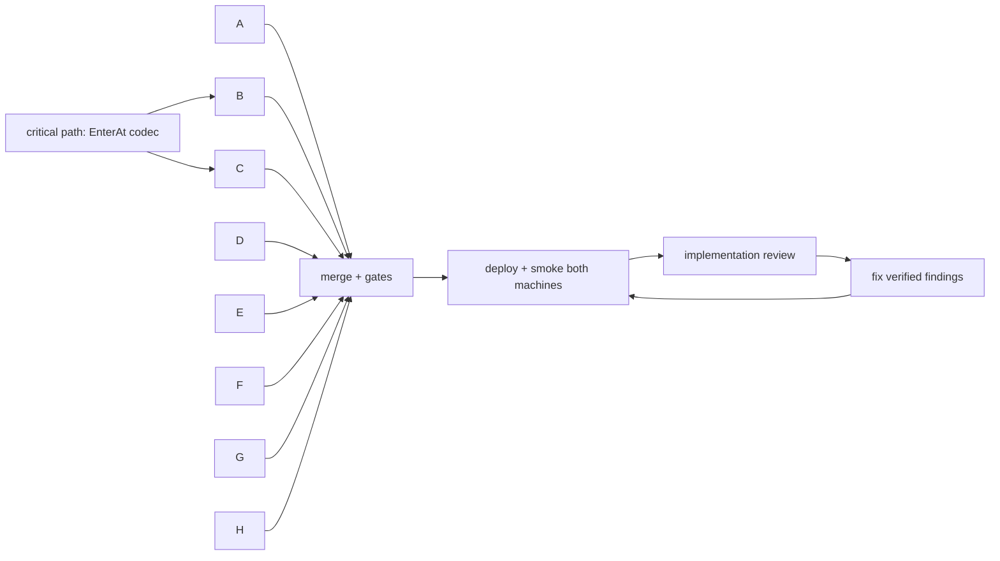

# Build loop: tasks/product-review.md

## Resolved placeholders

- TEST_CMD: `cargo test --workspace --release` (baseline 2026-10-11: 7 passed, 0 failed, 32 s)
- Lint gates: `cargo fmt --check`; `cargo clippy --workspace --all-targets --release` (Linux); `cargo clippy --release --target x86_64-pc-windows-gnu --all-targets --no-default-features`; macOS: `CC_aarch64_apple_darwin=/tmp/fakecc AR_aarch64_apple_darwin=/tmp/fakear cargo clippy --target aarch64-apple-darwin --all-targets --no-default-features`. Baseline warnings: 2 in mimouse (`redundant reference in info!`), 4 each in input-capture/input-emulation (`must_use`). No new warnings allowed.
- Env: `RUSTUP_HOME=/opt/lmbuild/rustup CARGO_HOME=/opt/lmbuild/cargo PATH=/opt/lmbuild/cargo/bin:$PATH`
- RUN_CMD: `mimouse.service` (user unit, cklaus) on gpumaster; scheduled task `MiMouse` on megapc (deploy via megapc-wsl, scripts in /tmp/mmsmoke).
- SMOKE_SCENARIO: restart both services; scripted crossing megapc -> gpumaster at y=600 succeeds on the first try (megapc log `client 0 acknowledged`, no `not connected`), receiver logs the placed point, double-tap Ctrl returns, `cli list --json` / `cli doctor --json` on both machines show healthy state.
- REVIEW_MODEL: invoking model, adversarial self-review + `reviewer` agent for the implementation review.
- RUN_BUDGET: unbounded.

## Critical path

`ProtoEvent::EnterAt` + length-aware decode (`src/proto.rs`, `src/listen.rs`, `src/connect.rs`). Gate: round-trip tests and a Lan Mouse decoder test (extended Enter decodes as plain Enter from a zero-padded 21-byte buffer). Done before dispatch.

## Tracks (file contention)

| Track | Items | Owns | Touches shared |
|---|---|---|---|
| A conn | R2, R3, U4 | src/connect.rs, src/listen.rs | src/emulation.rs (watchdog), src/capture.rs (drop -> release), src/service.rs (startup connect) |
| B capture | U3, R1, P2-send, P5, P1 | input-capture/**, src/capture.rs | src/config.rs (range, hotkey), src/ipc/mod.rs, src/cli.rs (focus), src/service.rs |
| C emulation | P2-receive, U1, U2 | input-emulation/** | src/emulation.rs (EnterAt), input-capture/src/macos.rs (scroll sign only) |
| D notify | P4, P6 | src/notify.rs, src/inhibit.rs (new) | src/service.rs (hooks), Cargo.toml (features) |
| E files | P3 | src/clipboard/** | src/config.rs (max_file_size) |
| F config | R4, R5 | src/crypto.rs | src/config.rs (write_back) |
| G setup | S1, S1b, S2 | src/pair.rs, src/discover.rs, src/doctor.rs (new) | src/cli.rs, src/ipc/mod.rs, src/clipboard/transport.rs (pair frames), src/service.rs |
| H packaging | S3 | packaging/**, .github/workflows/release.yml | Cargo.toml ([package.metadata.*]) |

Integration owner (main agent) merges track branches into `product-review` in the order H, F, A, C, D, E, B, G, resolves conflicts, owns README.md, AGENTS.md, config.toml (example), Cargo.lock, and runs gates + smoke. Agents never edit those files; they report doc changes in their final message.

Inside B the order is U3 -> R1 -> P2-send -> P5 -> P1 (each commit separately).

## Loops

- Inner (per item, inside a track agent): regression test first where behaviour changes -> implement -> fmt + clippy (Linux, Windows, macOS) + full TEST_CMD -> self-review (scope, no TODOs, no new crates without reason, matches file patterns) -> commit only own paths (`git commit -- <paths>`).
- Parallel dispatch: one git worktree per track at `/home/cklaus/src/mimouse-wt/<track>`, branch `pr/<track>`, target dir `/home/cklaus/src/mimouse-wt/target-<track>`.
- Integration: merge each branch, run all gates once per merge batch, compare to baseline.
- Smoke: once after all merges, again after review fixes. Hangs are failures (timeouts on every remote step).
- Implementation review: `reviewer` agent against finished code + acceptance criteria; reproduce each finding before fixing.
- Poison ceiling: a task failing its third attempt is parked blocked with dependents.

## Known-failure list

(empty)
