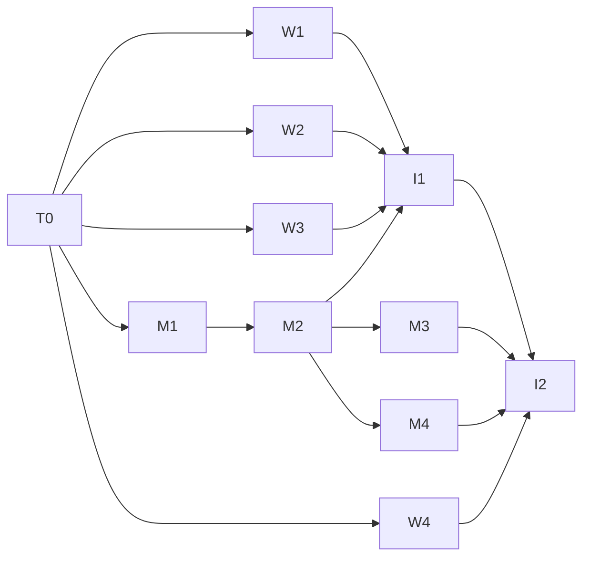

# Build loop: tasks/agent-control.md (P1 slice)

Branch `agent-control` (from `main` b39f6d8). Scope (user, 2026-10-18): C1, A2, A5, K1, A6, A7, A8, V1, V2, K2, K3, A9. Deferred: K4, K5, K6, K7, K8, P2 (spec marks them `[REVISED 2026-10-18 build: deferred]`). D8 decided by the user: a notice at session start and end on every OS.

## Resolved placeholders

- `<SPEC>`: `tasks/agent-control.md`.
- `<TEST_CMD>`: `cargo test --workspace`. Baseline 2026-10-18 at b39f6d8: 31 + 43 + 3 + 227 passed, 0 failed, 23 s incremental.
- Lint gates: `cargo fmt --check`; `cargo clippy --workspace --all-targets --all-features -- -D warnings`; `cargo clippy --release --target x86_64-pc-windows-gnu --all-targets --no-default-features -- -D warnings`; `CC_aarch64_apple_darwin=/tmp/fakecc AR_aarch64_apple_darwin=/tmp/fakear cargo clippy --target aarch64-apple-darwin --all-targets --no-default-features -- -D warnings`; `cargo deny check licenses bans sources` when a dependency changes. Baseline warnings: zero.
- Env: `RUSTUP_HOME=/opt/lmbuild/rustup CARGO_HOME=/opt/lmbuild/cargo PATH=/opt/lmbuild/cargo/bin:$PATH`.
- `<RUN_CMD>`: `mimouse.service` (user unit, cklaus) on gpumaster, binary `/usr/local/bin/mimouse`; scheduled task `MiMouse` on megapc (`ssh megapc-wsl`, `C:\Program Files\MiMouse\mimouse.exe`). Backups before each deploy.
- `<SMOKE_SCENARIO>`:
  1. gpumaster `self`: grant `self` screen only; `cli agent screenshot -o /tmp/x.png` returns a PNG whose size matches `hello` geometry; `cli agent key ctrl` with input denied returns `denied` and injects nothing. Input on `self` kept to one brief `pointer-to` (the user works on this desktop).
  2. gpumaster -> megapc over the agent channel: grant gpumaster's fingerprint on megapc; `hello` (capabilities, state, geometry 4880x2560); `screenshot --max-edge 1568` (factor ~3.11); `pointer-to` a known point and read the cursor back on megapc (PowerShell `[System.Windows.Forms.Cursor]::Position` in the desktop session); `type "grüße ✓"` into Notepad and read it back via the clipboard; `clip-set`/`clip-get` text round trip; revoking the fingerprint ends the session within 1 s.
  3. MCP: `mimouse mcp` driven by a JSON-RPC script: initialize, tools/list, screenshot, pointer_to, click, screenshot on megapc.
  4. Existing clipboard sync and pairing smoke unchanged (wl-copy on gpumaster -> Get-Clipboard on megapc).
  Success: every step's stated signal; timeout 120 s per step, a hang is a failure.
- `<FULL_SUITE_BUDGET>`: ~2 min Linux, ~6 min with both cross targets.
- `<RUN_BUDGET>`: unbounded. `<REVIEW_MODEL>`: `reviewer` agent.
- Known failures: none.

## Critical path

1. **Trust and grants (C1 + A2)**: a bug lets an authorized KVM peer drive or watch a machine without a grant, or keeps a revoked peer in control. Extra gate: service-level tests: no grant -> `denied` and nothing reaches emulation; grant revoked (config reload) mid-session -> session ends; fingerprint removed from `authorized_fingerprints` -> connection closed within `REVOCATION_CHECK` + margin; unknown op -> error with the id, connection stays.
2. **Preemption (A2)**: a stuck agent fighting the person. Extra gate: physical input / capture start / idle timeout each end the session with the right `EndReason`, and the session's held keys are released (dummy emulation records the key-ups).

A BLOCKED critical-path node halts the run.

## Task DAG

Worktrees `/home/cklaus/src/mimouse-wt/<track>`, branch `agent-<track>`, target dir `/home/cklaus/src/mimouse-wt/target-<track>`. Contract: `src/agent/proto.rs` + `desktop/src/lib.rs` (commit b76bb6a) and the API in the worker briefs (session artifact `agent-contract.md`).

| Id | Items | Track | Files (main) | Depends on |
|---|---|---|---|---|
| T0 | C1 contract | main | src/agent/{proto,keys}.rs, desktop/src/lib.rs (API), src/ipc/mod.rs, Cargo.toml | - (done b76bb6a) |
| W1 | A6, A7, V2 (emulation side) | emul | input-emulation/**, src/emulation.rs | T0 |
| W2 | V1, K2 settle, K3 encode, K1 locked/idle | desktop | desktop/** | T0 |
| W3 | A2 physical-input detection | physical | input-capture/src/physical/** | T0 |
| W4 | A9 | mcp | src/mcp.rs, src/main.rs | T0 |
| M1 | A2 grants config | main | src/config.rs, config.toml | T0 |
| M2 | C1 transport + A5 target sessions + D8 notices + audit | main | src/agent/target.rs, src/clipboard/transport.rs, src/clipboard/mod.rs, src/notify.rs, src/service.rs | M1 |
| M3 | requester proxy + IPC + CLI | main | src/agent/requester.rs, src/service.rs, src/cli.rs | M2 |
| M4 | A8 clipboard get/set | main | src/clipboard/mod.rs | M2 |
| I1 | integration: wire W1-W3 into the target, K1 Hello, K2 observe, K3 | main | src/agent/* | W1, W2, W3, M2 |
| I2 | docs: README, AGENTS.md, CHANGELOG, config example | main | docs | I1, W4 |

## Gates per task

Worker tasks: all lint gates + TEST_CMD green in their worktree before reporting. Main: after each merge, all gates; after I1, the smoke scenario; after I2, the review loop (`reviewer`, findings fixed until clean).

## Shared files

Owned by the main agent: Cargo.toml (root), Cargo.lock, workspace members, src/lib.rs, src/ipc/mod.rs, tasks/*. Workers edit only their listed files; the main agent resolves Cargo.lock on merge.
