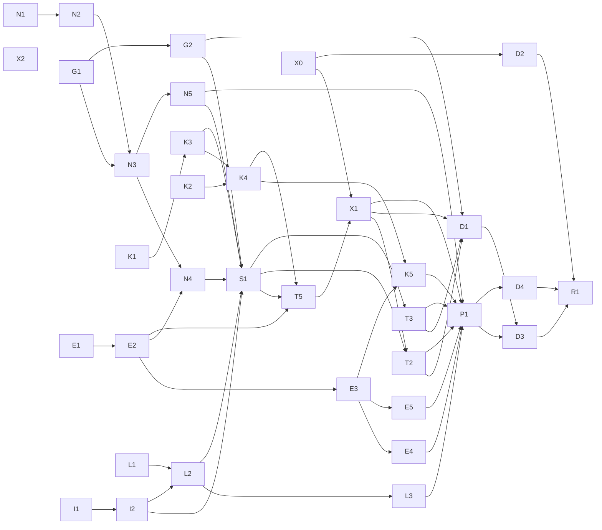

# Build loop: tasks/public-release.md (+ tasks/arch-review.md via D1)

Branch `product-review`. Spec items are the 54 arch-review items (B10 folded into A10) plus public-release T-1..T-6, T-1a, P1-P5. Needs-human N1-N4 (public-release.md) are excluded.

## Resolved placeholders

- `<SPEC>`: `tasks/public-release.md`, which pulls in all of `tasks/arch-review.md` (D1).
- `<TEST_CMD>`: `cargo test --workspace --release` (env below). Baseline 2026-10-14 at 4921556: 125 passed, 0 failed, 0 ignored (suites 0 / 11 / 14 / 3 / 97), ~110 s together with fmt + clippy.
- Lint gates: `cargo fmt --check`; `cargo clippy --workspace --all-targets --release` (Linux); `cargo clippy --release --target x86_64-pc-windows-gnu --all-targets --no-default-features`; macOS: `CC_aarch64_apple_darwin=/tmp/fakecc AR_aarch64_apple_darwin=/tmp/fakear cargo clippy --target aarch64-apple-darwin --all-targets --no-default-features`. Baseline warnings: mimouse 2 (`redundant reference in info!`), input-capture 4 and input-emulation 4 (`must_use` on async_trait). No new warnings allowed. After R0: `cargo deny check licenses bans sources`.
- Env: `RUSTUP_HOME=/opt/lmbuild/rustup CARGO_HOME=/opt/lmbuild/cargo PATH=/opt/lmbuild/cargo/bin:$PATH`; main-tree target dir `target-linux`.
- `<RUN_CMD>`: `mimouse.service` (user unit, cklaus) on gpumaster, binary `/usr/local/bin/mimouse`; scheduled task `MiMouse` on megapc, deployed through `megapc-wsl` with `/tmp/mmsmoke/mmdeploy.ps1`.
- `<SMOKE_SCENARIO>`: restart both services; `/tmp/mmsmoke/mmcross.ps1` on megapc crosses into gpumaster at y=600. Success signal, all of: megapc log `entering client 0`; gpumaster journal `entered at` with a fraction; Ctrl double-tap on gpumaster's emulated side returns (megapc log `releasing capture`); `mimouse cli list` exits 0 on both with `active: true`. Timeout 120 s per step; a hang is a failure. gpumaster's own capture waits for the GNOME dialog after each restart (GNOME 50), so the unattended smoke drives megapc -> gpumaster only.
- Headless desktops for P1 (installed): `sway` (`WLR_BACKENDS=headless`), `kwin_wayland --virtual`, `Xvfb` + `openbox`, `weston`.
- `<FULL_SUITE_BUDGET>`: one TEST_CMD + lint run, ~2 min Linux, ~6 min with both cross targets.
- `<RUN_BUDGET>`: unbounded. `<REVIEW_MODEL>`: `reviewer` agent.

## Critical path

1. **G1 (A-arch-5 config snapshot merge)**: every mutating CLI request, pairing and T7 write through it; a bug deletes users' clients and trusted keys. Extra gate: a round-trip table test over every config fixture (commented, unknown keys, symlinked file, invalid range, missing file): load -> write_back with no change is byte-identical; disk edited + memory edited on different keys merges both; same key both sides refuses; invalid disk refuses and leaves the file byte-identical.
2. **N3 (A-arch-2 trust module)**: input DTLS, clipboard TLS, pairing and doctor all verify through it; a bug either locks out every peer or trusts any. Extra gate: loopback matrix test with real DTLS and rustls handshakes: Policy {Authorized, Pinned(match), Pinned(mismatch), unpinned TOFU first/second cert} x {input, clipboard} with the expected accept/reject for each cell, plus the two-machine smoke after it merges.

A BLOCKED critical-path node halts the run.

## Task DAG

Tracks group tasks by file scope; each track runs in its own worktree `/home/cklaus/src/mimouse-wt/<track>` on branch `pr/<track>` with target dir `/home/cklaus/src/mimouse-wt/target-<track>` (absolute).

| Id | Items | Track | Files (main) | Depends on |
|---|---|---|---|---|
| N1 | A1 | net | src/listen.rs | - |
| N2 | A6, B1 | net | vendor/webrtc-util/src/conn/conn_udp_listener.rs, src/listen.rs | N1 |
| N3 | A-arch-2, A2, B4 | net | src/crypto.rs (+`crypto::peers`), src/connect.rs, src/listen.rs, src/clipboard/transport.rs, src/pair.rs, src/doctor.rs, src/config.rs (`fingerprint` key), src/service.rs (`paired`) [REVISED 2026-10-14: + src/ipc/mod.rs (`ClientConfig.fingerprint`), src/client.rs (pin), src/clipboard/mod.rs (`client_sender` passes the pin)] | N2, G1 |
| N4 | B2, B3, B5 | net | src/listen.rs, src/clipboard/transport.rs, src/notify.rs, src/emulation.rs (`rejected_connections`), src/service.rs (revocation) [REVISED 2026-10-14: + src/pair.rs (`Incoming` carries the clipboard connection permit; disjoint hunks from N5's C10 edits, merged by the integrator)] | N3, E2 |
| N5 | C4, C10 | net | src/connect.rs, src/discover.rs, src/doctor.rs, src/pair.rs | N3 |
| E1 | A9 | emu | src/proto.rs, input-emulation/src/wlroots.rs | - |
| E2 | A7, A8, B16 | emu | input-emulation/src/{windows,lib,dummy}.rs, src/emulation.rs | E1 |
| E3 | A-arch-4, B15, B17, B18, B19, B20 | emu | input-emulation/src/*, input-event/src/macos_scroll.rs, src/capture.rs (`leave_events`) | E2 |
| E4 | C13, C14 | emu | input-emulation/src/{libei,wlroots}.rs | E3 |
| E5 | T6 | emu | input-emulation tests, tests/fixtures/ | E3 |
| K1 | A4 | cap | input-capture/src/lib.rs, src/capture.rs | - |
| K2 | B11 | cap | input-capture/src/layer_shell.rs | - |
| K3 | A10 (B10 folded) | cap | input-capture/src/lib.rs | K1 |
| K4 | A-arch-3, B12, B13, B14 | cap | input-capture/src/{lib,libei,macos}.rs, input-capture/src/windows/* | K2, K3 |
| K5 | C1, C2, C12 | cap | src/capture.rs, input-capture/src/{windows/event_thread,macos,chord}.rs | K4, E3 |
| G1 | A-arch-5, A3, T7, C3, B7 | cfg | src/config.rs, src/audit.rs, src/service.rs (save paths), src/doctor.rs | - |
| G2 | C5, C9 | cfg | src/audit.rs, src/config.rs, src/service.rs (`change-port`) | G1 |
| I1 | A5, B3b | ipc | src/ipc/listen.rs, src/ipc/windows.rs | - |
| I2 | B9, C11 | ipc | src/ipc/listen.rs, src/cli.rs, src/main.rs | I1 |
| L1 | A11 | clip | src/clipboard/{windows,portal,mod}.rs | - |
| L2 | B21, B22, B23, B24 | clip | src/clipboard/*, src/cli.rs, src/doctor.rs (status) | L1, I2 |
| L3 | C6, C7, C8 | clip | src/clipboard/* | L2 |
| S1 | A-arch-1, B6, B8 | svc | src/service.rs, src/client.rs, src/dns.rs, src/clipboard/mod.rs (`ClientRemoved`) [REVISED 2026-10-14: + src/config.rs `changed()` (watcher Err was `expect`ed, aborting the service; now log + continue), approved by integrator; no concurrent owner] | G2, N4, N5, K3, I2, L2 |
| T5 | T5 | svc | src/ipc/mod.rs, src/cli.rs, src/doctor.rs, input-capture/src/lib.rs, input-emulation/src/lib.rs [REVISED 2026-10-14: + the code half of T4 (log restart-only keys changed on disk, once per reload; it needs the same disk-vs-effective diff as `cli config`), and as needed src/{config,service,clients,capture,emulation,main}.rs outside capture.rs tests; T3 runs concurrently on test modules only; D1 keeps T4's README text] | S1, E2, K4 |
| T2 | T2 | cfg | src/config.rs, consts in src/{connect,emulation,pair}.rs | S1, X1 |
| T3 | T3 | svc | Cargo.toml (dev tokio `test-util`), tests in src/{connect,capture,inhibit,approval}.rs | S1 |
| X0 | T-1a | rel | deny.toml, .github/workflows/rust.yml, AGENTS.md (gate) | - |
| W1 | P2 REVISED (Defender) | rel | build.rs, Cargo.toml/Cargo.lock (`winresource` build-dep, MIT) | - | [added 2026-10-14 by integrator after the wave-1 smoke: Defender ML quarantine] |
| X1 | T-1, T-2, T-3, T-4 | rel | src/telemetry.rs (new), src/cli.rs, src/config.rs, src/main.rs, .github/workflows/release.yml, Cargo.toml (`rustls-native-certs`) | S1, T5, X0 |
| X2 | T-5 | rel | telemetry-collector/ (new) | - |
| D1 | T4, T-6, P5 | docs | README.md, .github/FUNDING.yml, packaging/winget locale, src/main.rs/cli (`after_help`) | X1, T2, T3, G2 |
| D2 | P3 | docs | .github/ISSUE_TEMPLATE/, SECURITY.md, CONTRIBUTING.md | X0 |
| P1 | P1 | smoke | README platform table, tasks/ smoke logs | all code nodes (E4, E5, K5, L3, N5, T2, T3, X1) |
| D3 | P2 | docs | README.md | P1, D1 |
| D4 | T1, T8 | docs | AGENTS.md | P1 |
| R1 | P4 (version, CHANGELOG, CI on PR; merge and tag are needs-human row N3 of public-release.md) | rel | Cargo.toml, Cargo.lock, packaging/*, CHANGELOG.md, .github/workflows/rust.yml | D3, D4, D2 |

35 nodes; every non-needs-human item appears exactly once (topological sort and coverage checked 2026-10-14 before Step 4). Longest chain: N1 -> N2 -> N3 -> N4 -> S1 -> T5 -> X1 -> T2 -> D1 -> D3 -> R1: 11.

### Contention (implicitly shared files)

- `src/service.rs`: G1, N3, N4, G2, S1. These never run concurrently: G1 before N3 (edge), N4/G2 run in different waves (wave plan below), S1 after all.
- `src/config.rs`: G1, N3, G2, T2, X1 (sequenced by edges G1 -> N3, G1 -> G2, S1 -> T2/X1, X1 -> T2).
- `src/doctor.rs`: G1, N3, N5, L2, T5. `src/cli.rs`: I2, L2, T5, X1, D1.
- `Cargo.toml`/`Cargo.lock`, `README.md`, `AGENTS.md`, `tasks/*`: integration owner (main agent) only. A track that needs a dependency asks the owner; README/AGENTS lines for a task are written by the owner at merge time from the task's `doc_text`.

### Wave plan (parallel dispatch)

| Wave | Concurrent tracks (disjoint files) |
|---|---|
| 1 | net: N1 -> N2; emu: E1 -> E2; cap: K1 -> K3, K2; cfg: G1; ipc: I1 -> I2; clip: L1; rel: X0, X2; docs: D2 |
| 2 | net: N3 (after G1, N2 merged) -> N5; emu: E3 -> E4, E5; cap: K4 -> K5 (after E3 for K5); clip: L2 -> L3; cfg: G2 |
| | [REVISED 2026-10-14, re-plan loop: N3 shares `doctor.rs`/`clipboard/transport.rs` with L2 and `config.rs`/`service.rs` with G2; N4 shares `transport.rs` with L2 and `service.rs` with G2; N5 shares `doctor.rs` with L2. Valid schedule: **2a** net N3, emu E3 -> E4, E5, cap K4; **2b** (N3 merged) net N4, net2 N5, cap K5 (after E3, K4); **2c** (N4, N5 merged) clip L2 -> L3, cfg G2; then S1 (L3 may follow S1).] |
| 3 | net: N4; then svc: S1 |
| 4 | svc: T5, T3; then rel: X1; then cfg: T2 |
| 5 | P1 smoke matrix; docs D1, D4; then D3; then R1 |
| | [REVISED 2026-10-14, wave 5: ~30 tracks of collected `doc_text` (session artifact `doc-text.md`) are still unwritten, too much for the owner to write serially. README (D1 then D3, one agent, worktree `readme`) and AGENTS (D4, one agent, worktree `agents`) each get one doc agent with exclusive ownership of that file; the owner reviews every line against the code and the specs before merging. P1 is done (all six rows recorded in public-release P1; macOS stays experimental/needs-human).] |

Within a wave, a node starts when its dependencies are merged into `product-review`.

## Loops

**Inner loop (one task).** Trigger: a ready node. Steps: re-read the spec item(s) and cited lines (status "reported" means re-verify first; a false item is marked `[REVISED: …]` in the spec and closed with evidence) -> write the failing test (behaviour change) -> fix -> TEST_CMD + all lint gates in the worktree -> self-review checklist -> commit with paths (`git commit -m "<id>: …" -- <paths>`). Exit: gates green vs. baseline, or 3rd failed attempt (poison).
Self-review checklist: diff confined to the node's files; no TODO/dead code; no secret values in any file; reused existing modules/deps first; no speculative abstraction; matches the file's existing pattern unless the node is the pattern change; diff size fits the node; README/AGENTS text supplied as `doc_text` for user-visible changes; Windows/macOS code cross-compiles.

**Outer loop.** Pick ready nodes by wave order then id, dispatch inner loops, merge finished branches into `product-review` (owner resolves conflicts, re-runs all gates on the merge), mark done in `tasks/todo.md`, re-evaluate readiness.

**Parallel dispatch loop.** One subagent per track in the current wave, own worktree and absolute target dir, branch `pr/<track>` cut from the latest `product-review`. Never two tracks with a shared file at once (contention list above). Agents commit only their own paths and never edit Cargo.lock/README/AGENTS/tasks.

**Meta loop.** After a correction or failure: `tasks/lessons.md` (mistake -> rule). Reality differs from plan: update this file and the spec with `[REVISED: …]`.

**Full-suite regression loop.** After every merge into `product-review`: TEST_CMD + all lint gates on the merged tree, compared with the baseline (125 passed, 0 failed, baseline warnings). A new failure blocks the merge unless listed below after the 3-run procedure in the skill.

**Smoke loop.** After each wave: build Linux + Windows release, deploy to gpumaster and megapc, run SMOKE_SCENARIO with its signal, 120 s per step. Afterwards `git status --short --ignored` shows only known build dirs. Wave 2 also smokes N3 on both machines (pinned and TOFU peers). P1 runs the headless desktops.

**Implementation review loop.** After every non-needs-human node is DONE: read-only `reviewer` against `git diff 4921556..product-review` and both specs' acceptance lines. Reproduce each finding (failing test or observed output) before fixing; fixes are new nodes R-n; every disposition goes in the report.

**Re-plan loop.** A node whose "reported" item turns out false or whose fix needs a file outside its row: stop that node, update this table (files, edges), re-run the contention check, continue. Justification: half the B items are reviewer-reported only.

## Gates & handling

- Poison ceiling: attempt 3 fails -> node BLOCKED, dependents blocked transitively; G1 or N3 BLOCKED halts the run.
- New dependency: only `rustls-native-certs` (X1, license MIT/Apache-2.0/ISC) and `test-util` feature (T3) are planned; anything else needs a one-line reason in the commit and a deny check.
- Resumability: commit messages start with the node id; on resume, `git log --oneline 4921556..product-review | grep -oE '^[0-9a-f]+ [A-Z][0-9]+'` rebuilds `tasks/todo.md`.
- Windows/macOS-only code: cross-compiled + unit-tested; listed as hardware-unverified unless smoked on megapc.
- X1 contract (from X2, merged 687026b): the client serializes exactly `telemetry-collector/schema.json`: every field always present (null where nullable), closed objects, days <= 7, crashes <= 8, crash `capture_backend` + `emulation_backend` (not one `backend`), switches `{edge, hotkey, cli_focus}`, size buckets `lt_1k/lt_64k/lt_1m/lt_64m/ge_64m`, approval buckets `lt_10s/lt_60s/ge_60s`, `cli_commands` keys `^[a-z][a-z0-9_]{0,31}$` (<= 64), lowercase UUID v4 install id, `commit` may be `""`, `Content-Type: application/json`, success = 204. `telemetry_endpoint` / `MIMOUSE_TELEMETRY_URL` is a base URL; the client appends `/v1/batch` and `/v1/installs/<id>`. Client test round-trips a batch through the collector's validator (`node` + `telemetry-collector/src/validate.js`) or checks against `example-batch.json` field-for-field.

## Known-failure list

(empty)
